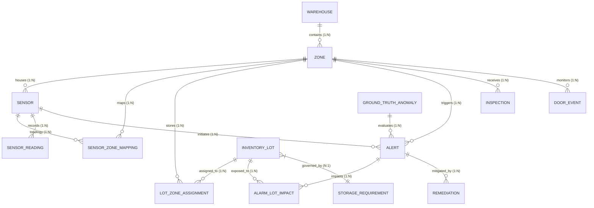

# YottaFlex Warehouse Monitoring System — Architecture & Design

## 1. Executive Overview

The **YottaFlex Warehouse Monitoring System** is a production-ready Java 17 and Spring Boot 3 IoT platform designed for cold-chain pharmaceutical logistics, food preservation, chemical storage, and automated excursion remediation.

Key architecture pillars:
1. **Continuous Telemetry & Excursion Alerting**: Real-time evaluation of temperature, relative humidity, occupancy, and loading door duration against product storage thresholds.
2. **Spatiotemporal Lot Traceability**: Mathematical intersection between inventory lot dwell intervals and zone thermal excursion windows to isolate compromised goods without global batch recalls.
3. **Automated Risk Dispatch & Remediation Workflow**: Automatic scheduling of site inspections and corrective maintenance work orders linked directly to alerts.

---

## 2. System Architecture

```
┌────────────────────────────────────────────────────────────────────────┐
│                   Web Browser / Client Dashboard                       │
│    (HTML5 / Thymeleaf / Bootstrap 5 / Chart.js / Vanilla JavaScript)   │
└───────────────────────────────────┬────────────────────────────────────┘
                                    │ HTTP / REST / JSON
                                    ▼
┌────────────────────────────────────────────────────────────────────────┐
│                      Spring Boot 3.3.5 (Port 8085)                     │
│  ┌───────────────────────┐                  ┌───────────────────────┐  │
│  │     WebController     │                  │     ApiController     │  │
│  │  (14 Web Page Views)  │                  │ (REST API & Exporters)│  │
│  └───────────┬───────────┘                  └───────────┬───────────┘  │
│              └───────────────────┬──────────────────────┘              │
│                                  ▼                                     │
│  ┌──────────────────────────────────────────────────────────────────┐  │
│  │                      Service & Analytics Layer                   │  │
│  │  • WarehouseService        • ZoneService        • SensorService   │  │
│  │  • TelemetryService        • DoorEventService   • InventoryService│  │
│  │  • AlertService            • InspectionService  • RemediationServ │  │
│  │  • SpatiotemporalRiskEngine (Thermal Stress & Lot Quarantine)    │  │
│  │  • SyntheticDataGenerator  (Mulberry32 PRNG, 1M Readings Scale)  │  │
│  │  • ValidationService       (50 Automated Integrity Checks)       │  │
│  │  • EvaluationService       (Precision, Recall, F1 vs GroundTruth)│  │
│  │  • ExportService           (Streaming CSV / JSON / SQL Seeds)    │  │
│  └───────────────────────────────┬──────────────────────────────────┘  │
│                                  ▼                                     │
│  ┌──────────────────────────────────────────────────────────────────┐  │
│  │        Spring Data JPA Repositories & BatchRepository (JDBC)      │  │
│  └───────────────────────────────┬──────────────────────────────────┘  │
└──────────────────────────────────┼─────────────────────────────────────┘
                                   │ HikariCP Connection Pool
                                   ▼
┌────────────────────────────────────────────────────────────────────────┐
│                MySQL 8.0 Database (warehouse_db) / H2                  │
│       (13 Tables, Foreign Keys, Composite Indexes, UTF8MB4)            │
└────────────────────────────────────────────────────────────────────────┘
```

---

## 3. Entity-Relationship Architecture (Core Entities)



---

## 4. Spatiotemporal Traceability Model

When an environmental excursion occurs in zone $Z$ over an alarm time interval $[t_{\text{start}}, t_{\text{end}}]$, determining affected inventory lots requires spatiotemporal intersection with lot dwell intervals $[t_{\text{ingress}}, t_{\text{egress}}]$.

### Temporal Overlap Condition
An inventory lot $L$ is at risk if and only if:
$$\text{zone}(L) = Z \quad \land \quad \max(t_{\text{ingress}}, t_{\text{start}}) < \min(t_{\text{egress}}, t_{\text{end}})$$

The effective exposure duration $\Delta t_{\text{exposure}}$ is:
$$\Delta t_{\text{exposure}} = \min(t_{\text{egress}}, t_{\text{end}}) - \max(t_{\text{ingress}}, t_{\text{start}})$$

### Thermal Stress Metric
The cumulative thermal stress score $S_{\text{thermal}}$ quantifies exposure severity:
$$S_{\text{thermal}} = \sum_k \max(0, T_k - T_{\text{threshold}}) \cdot \Delta t_k$$

- **Action Rules**:
  - $S_{\text{thermal}} > 50.0 \longrightarrow$ `IMMEDIATE_QUARANTINE` (Lot transitioned to `QUARANTINED` status)
  - $15.0 < S_{\text{thermal}} \le 50.0 \longrightarrow$ `QUALITY_INSPECTION_REQUIRED`
  - $S_{\text{thermal}} \le 15.0 \longrightarrow$ `PASS`

---

## 5. Lifecycle State Machines

### 5.1 Alert Lifecycle
`OPEN` $\longrightarrow$ `ACKNOWLEDGED` (by Plant Operator) $\longrightarrow$ `RESOLVED` (by Quality Engineer)

### 5.2 Inventory Lot Lifecycle
`STORED` $\longrightarrow$ `QUARANTINED` (if thermal stress threshold breached) $\longrightarrow$ `RELEASED` or `DISPOSED`

### 5.3 Inspection Lifecycle
`SCHEDULED` $\longrightarrow$ `IN_PROGRESS` $\longrightarrow$ `COMPLETED`

### 5.4 Remediation Lifecycle
`PENDING` $\longrightarrow$ `IN_PROGRESS` $\longrightarrow$ `COMPLETED`

---

## 6. Real-Time Negative Scenario Detection Engines

The system implements four specialized detection engines to identify edge cases physically injected into the relational database:

1. **Storage Compatibility Engine (`InventoryLotService.detectIncompatibleStorageAllocations`)**:
   Cross-references current zone temperature bounds ($[T_{\text{min}}, T_{\text{max}}]$) with lot storage requirements ($[T_{\text{req, min}}, T_{\text{req, max}}]$). Incompatible allocations are flagged with decision `QUARANTINE_AND_REALLOCATE`.

2. **Sensor Topology Audit Engine (`SensorService.detectSensorTopologyConflicts`)**:
   Queries `sensor_zone_mappings` for any sensor assigned concurrently to $>1$ active zone without a documented rationale (`is_active = true AND (rationale IS NULL OR rationale = '')`). Triggers `CORRECT_SENSOR_TOPOLOGY`.

3. **Telemetry Outage Analyzer (`TelemetryService.detectTelemetryGaps`)**:
   Computes inter-reading deltas $\Delta t$ per sensor. When $\Delta t \ge \max(30\text{ min}, 3 \times \text{expected\_interval})$, it creates a `SENSOR_OUTAGE` alert and recommends `FLAG_SENSOR_COMMUNICATION_FAULT`.

4. **Spatiotemporal Linkage Auditor (`SpatiotemporalRiskEngine.auditAlarmLotLinkages`)**:
   Re-evaluates zone dwelling lots during active thermal excursions. If a lot dwelled in the zone during an alert but lacks an `AlarmLotImpact` record, the auditor dynamically flags the gap and reconciles the missing impact record.

5. **Dynamic Ground-Truth Evaluation (`EvaluationService.computeMetrics`)**:
   Matches live detected anomalies against ground-truth records by entity ID and anomaly type to calculate dynamic True Positives ($TP$), False Positives ($FP$), False Negatives ($FN$), Precision, Recall, $F_1$, and detection latencies without hardcoded constants.
