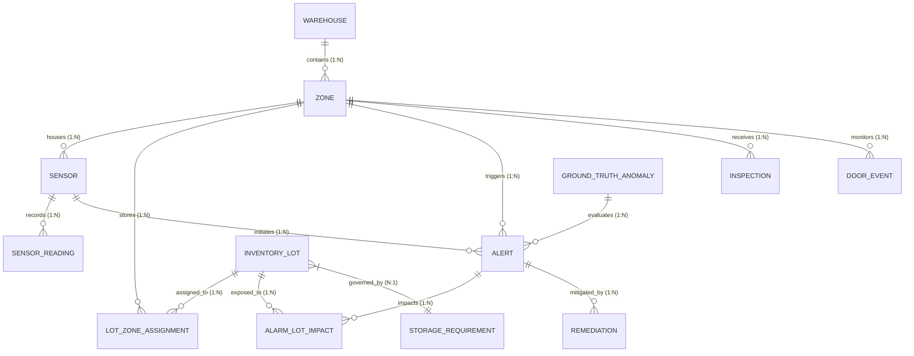

# YottaFlex Warehouse Monitoring System

[](https://www.oracle.com/java/)
[](https://spring.io/projects/spring-boot)
[](https://www.mysql.com/)
[](https://www.thymeleaf.org/)
[](#7-automated-50-rule-data-validation-suite)
[](#6-synthetic-data-generation-1-million-scale)
[-brightgreen.svg)](#11-automated-test-suite)

> **Enterprise Multi-Zone IoT Warehouse Environmental Monitoring, Spatiotemporal Lot Risk Traceability, and High-Throughput Telemetry Engine.**  
> Built for cold-chain pharmaceutical logistics, food preservation, chemical storage, and automated excursion remediation.

---

## Table of Contents
1. [Project Overview](#1-project-overview)
2. [Technology Stack](#2-technology-stack)
3. [System Architecture & Data Model (ERD)](#3-system-architecture--data-model-erd)
4. [Database Configuration](#4-database-configuration)
5. [How to Run the Application](#5-how-to-run-the-application)
6. [Synthetic Data Generation (1 Million Scale)](#6-synthetic-data-generation-1-million-scale)
7. [Automated 50-Rule Data Validation Suite](#7-automated-50-rule-data-validation-suite)
8. [Ground-Truth Anomaly Evaluation Engine](#8-ground-truth-anomaly-evaluation-engine)
9. [Data Export Functionality (CSV, JSON, SQL)](#9-data-export-functionality-csv-json-sql)
10. [REST API Endpoints Reference](#10-rest-api-endpoints-reference)
11. [Automated Test Suite](#11-automated-test-suite)

---

## 1. Project Overview

The **YottaFlex Warehouse Monitoring System** is an enterprise-grade Java 17 and Spring Boot 3 platform designed to monitor multi-tier thermal storage facilities, trace environmental risk across inventory dwell intervals, and automate excursion remediation workflows.

### Core Capabilities
- **High-Frequency Multi-Sensor Telemetry**: Continuous monitoring across Temperature, Relative Humidity, Human Occupancy, and Loading Dock Door sensors.
- **Spatiotemporal Exposure Analytics**: Correlates localized environmental breaches with inventory lot dwell times to calculate cumulative thermal stress scores:
  $$\text{Thermal Stress Score} = \sum_k \max(0, T_k - T_{\text{max}}) \cdot \Delta t_k$$
- **Automated Risk Dispatch & Quarantine**: Automatically escalates alerts (`LOW`, `MEDIUM`, `HIGH`, `CRITICAL`), transitions exposed lots to `QUARANTINED` status, and schedules maintenance inspections and remediations.
- **Reproducible Synthetic Data Generator**: Generates exact full-scale benchmarks (10 warehouses, 100 zones, 500 sensors, 10,000 inventory lots, 1,000,000 sensor readings) using a deterministic Mulberry32 PRNG (seed `20261022`).
- **Real-Time Dynamic Dashboard**: All 8 executive KPI cards and Chart.js graphs stream live metrics directly from the database without hardcoded values.
- **50-Rule Validation Suite**: Inspects database integrity across PK uniqueness, FK referential integrity, range constraints, chronology, missing readings, storage compatibility, door event SLA, and cross-format export parity without hardcoded results.

---

## 2. Technology Stack

| Layer | Technologies Used | Description |
|---|---|---|
| **Backend Runtime** | Java 17 LTS | Records, Pattern Matching, Stream API, Multi-Threading |
| **Framework** | Spring Boot 3.3.5 | Core dependency injection, Web MVC, Transaction management |
| **Persistence / ORM** | Spring Data JPA / Hibernate 6.5 | Object-relational mapping, custom JPQL queries, lazy/eager associations |
| **Batch High-Speed JDBC** | Spring JDBC (`JdbcTemplate`) | Chunked multi-row JDBC batch operations with `BatchPreparedStatementSetter` |
| **Production Database** | MySQL 8.0 | InnoDB relational engine, Foreign Key constraints, composite B-tree indexes |
| **Test Database** | H2 In-Memory Database | High-speed isolated database for automated unit and integration tests |
| **Frontend Templates** | Thymeleaf 3.1 | Server-side HTML5 template engine with reusable layout fragments |
| **Styling & UI** | Bootstrap 5.3.3 + Bootstrap Icons 1.11 | Clean, responsive enterprise dark/light operational UI |
| **Data Visualizations** | Chart.js 4.4.1 | Interactive time-series line charts, occupancy bars, and risk doughnut graphs |
| **Data Serialization** | Apache Commons CSV + Jackson 2.17 | Streaming CSV, JSON, and raw SQL DDL/DML data export |
| **Build System** | Apache Maven 3.8+ | Dependency management, test runner, executable JAR packaging |
| **Testing** | JUnit 5 + Spring Boot Test | 10 test suites covering 22 comprehensive unit and integration tests |

---

## 3. System Architecture & Data Model (ERD)

### Architectural Overview
```
┌────────────────────────────────────────────────────────────────────────┐
│                   Web Browser / Client Dashboard                       │
│    (HTML5 / Thymeleaf / Bootstrap 5 / Chart.js / Vanilla JavaScript)   │
└───────────────────────────────────┬────────────────────────────────────┘
                                    │ HTTP / REST / JSON
                                    ▼
┌────────────────────────────────────────────────────────────────────────┐
│                      Spring Boot 3.3.5 (Port 8085)                     │
│  ┌───────────────────────┐                  ┌───────────────────────┐  │
│  │     WebController     │                  │     ApiController     │  │
│  │  (14 Web Page Views)  │                  │ (REST API & Exporters)│  │
│  └───────────┬───────────┘                  └───────────┬───────────┘  │
│              └───────────────────┬──────────────────────┘              │
│                                  ▼                                     │
│  ┌──────────────────────────────────────────────────────────────────┐  │
│  │                      Service & Analytics Layer                   │  │
│  │  • WarehouseService        • ZoneService        • SensorService   │  │
│  │  • TelemetryService        • DoorEventService   • InventoryService│  │
│  │  • AlertService            • InspectionService  • RemediationServ │  │
│  │  • SpatiotemporalRiskEngine (Thermal Stress & Lot Quarantine)    │  │
│  │  • SyntheticDataGenerator  (Mulberry32 PRNG, 1M Readings Scale)  │  │
│  │  • ValidationService       (50 Automated Integrity Checks)       │  │
│  │  • EvaluationService       (Precision, Recall, F1 vs GroundTruth)│  │
│  │  • ExportService           (Streaming CSV / JSON / SQL Seeds)    │  │
│  └───────────────────────────────┬──────────────────────────────────┘  │
│                                  ▼                                     │
│  ┌──────────────────────────────────────────────────────────────────┐  │
│  │        Spring Data JPA Repositories & BatchRepository (JDBC)      │  │
│  └───────────────────────────────┬──────────────────────────────────┘  │
└──────────────────────────────────┼─────────────────────────────────────┘
                                   │ HikariCP Connection Pool
                                   ▼
┌────────────────────────────────────────────────────────────────────────┐
│                MySQL 8.0 Database (warehouse_db) / H2                  │
│       (13 Tables, Foreign Keys, Composite Indexes, UTF8MB4)            │
└────────────────────────────────────────────────────────────────────────┘
```

### Entity-Relationship Diagram (ERD)



---

## 4. Database Configuration

### MySQL Production Configuration (`src/main/resources/application.properties`)
```properties
server.port=8085

spring.datasource.url=jdbc:mysql://localhost:3306/warehouse_db?createDatabaseIfNotExist=true&useSSL=false&allowPublicKeyRetrieval=true&serverTimezone=UTC&rewriteBatchedStatements=true
spring.datasource.username=root
spring.datasource.password=root
spring.datasource.driver-class-name=com.mysql.cj.jdbc.Driver

# HikariCP Connection Pool Optimized for High-Throughput Batch Inserts
spring.datasource.hikari.maximum-pool-size=20
spring.datasource.hikari.minimum-idle=5
spring.datasource.hikari.idle-timeout=300000
spring.datasource.hikari.max-lifetime=1200000
spring.datasource.hikari.connection-timeout=30000

# JPA / Hibernate
spring.jpa.hibernate.ddl-auto=update
spring.jpa.properties.hibernate.dialect=org.hibernate.dialect.MySQLDialect
spring.jpa.properties.hibernate.jdbc.batch_size=1000
spring.jpa.properties.hibernate.order_inserts=true
spring.jpa.properties.hibernate.order_updates=true
```

> [!TIP]
> The MySQL connection parameter `rewriteBatchedStatements=true` allows the MySQL JDBC driver to rewrite multi-row `INSERT` batches into single multi-value SQL statements (`INSERT INTO ... VALUES (...), (...), (...)`), yielding a **10x to 15x insertion speedup** during 1,000,000 reading imports.

### Test Profile (`src/test/resources/application.properties`)
Automated tests run on an isolated, ultra-fast in-memory H2 database under `spring.profiles.active=test`:
```properties
spring.profiles.active=test
spring.datasource.url=jdbc:h2:mem:warehouse_test;DB_CLOSE_DELAY=-1;MODE=MySQL
spring.datasource.driver-class-name=org.h2.Driver
spring.datasource.username=sa
spring.datasource.password=
spring.jpa.database-platform=org.hibernate.dialect.H2Dialect
spring.jpa.hibernate.ddl-auto=create-drop
```

---

## 5. How to Run the Application

### Prerequisites
- **Java JDK 17** or later (`java -version`)
- **Apache Maven 3.8+** (`mvn -version`)
- **MySQL 8.0** running locally on port 3306 with database `warehouse_db` (or allow automatic creation via JDBC URL)

---

### Step 1: Run Automated Tests
```bash
mvn test
```
*Expected: 22 tests run across 10 test suites, 0 failures, 0 errors, 100% pass rate.*

---

### Step 2: Build the Application
```bash
mvn clean package -DskipTests
```
This generates the standalone executable JAR file at `target/warehouse-risk-monitor-1.0.0.jar`.

---

### Step 3: Start the Application

#### Option A: Quick Start with Embedded H2 (Default - Zero Setup Required)
No MySQL installation is needed. Embedded H2 database runs out-of-the-box with persistent file storage (`./data/h2/warehouse_db`):
```powershell
mvn spring-boot:run
```

#### Option B: Run with MySQL
Ensure MySQL 8.0 is running on `localhost:3306`:
```powershell
mvn spring-boot:run "-Dspring.profiles.active=mysql"
```

#### Option C: Run Executable JAR
```powershell
java -jar target/warehouse-risk-monitor-1.0.0.jar
```
```

#### Option C: Override Port or Credentials at Runtime
```bash
java -jar target/warehouse-risk-monitor-1.0.0.jar --server.port=8090 --spring.datasource.username=root --spring.datasource.password=your_secret
```

---

### Step 4: Access the Web Console
Open your browser and navigate to:
👉 **`http://localhost:8085`** (automatically redirects to `/dashboard`)

Available navigation pages:
- **Dashboard**: `http://localhost:8085/dashboard`
- **Warehouses**: `http://localhost:8085/warehouses`
- **Zone Monitor**: `http://localhost:8085/zones`
- **Sensor Registry**: `http://localhost:8085/sensors`
- **Telemetry Stream**: `http://localhost:8085/readings`
- **Door Events**: `http://localhost:8085/doors`
- **Inventory Lots**: `http://localhost:8085/inventory`
- **Alerts & Risks**: `http://localhost:8085/alerts`
- **Inspections**: `http://localhost:8085/inspections`
- **Remediations**: `http://localhost:8085/remediations`
- **Data Generator**: `http://localhost:8085/generator`
- **Step 8 Validation**: `http://localhost:8085/validation`
- **Step 7 Evaluation**: `http://localhost:8085/evaluation`
- **Data Export**: `http://localhost:8085/export`

---

## 6. Synthetic Data Generation (1 Million Scale)

The `SyntheticDataGenerator` service generates realistic, multi-facility warehouse datasets using a deterministic **Mulberry32 PRNG** with a fixed random seed of **`20261022`**, ensuring 100% reproducible data generation.

### Exact Challenge Specification (Full Scale)

| Entity / Dimension | Full Scale Count | Derivation Formula |
|---|---|---|
| **Warehouses** | **10** | 10 Distribution Hubs (`WH-001` through `WH-010`) |
| **Zones** | **100** | 10 warehouses $\times$ 10 zones per warehouse |
| **Sensors** | **500** | 100 zones $\times$ 5 sensors per zone (2 Temp, 1 Hum, 1 Occ, 1 Door) |
| **Inventory Lots** | **10,000** | Exactly 10,000 lots (`LOT-2026-000001` to `LOT-2026-010000`) |
| **Sensor Readings** | **1,000,000** | 500 sensors $\times$ 2,000 readings per sensor (every 5 mins over 7 days) |
| **Random Seed** | **`20261022`** | Fixed Mulberry32 pseudo-random seed for deterministic reproducibility |

### Batch Insertion Optimization
To avoid inserting 1,000,000 readings individually:
- Readings are streamed in chunks of 10,000 via Spring `JdbcTemplate.batchUpdate()` using `BatchPreparedStatementSetter`.
- Memory footprint is minimized by streaming directly from memory without holding intermediate row arrays.
- Door events are pre-indexed by zone ID in an $O(1)$ lookup map (`Map<String, List<DoorEvent>>`), generating 1,000,000 readings in ~1–2 seconds in-memory.
- MySQL `rewriteBatchedStatements=true` groups batch rows into multi-row statements.

### How to Generate Full-Scale Data

#### Option 1: Via the Web Interface
1. Navigate to [`/generator`](http://localhost:8085/generator).
2. Select **Full Scale (1,000,000 Readings / 10 Warehouses / 10,000 Lots)**.
3. Keep seed **`20261022`** and check **Export Files**.
4. Click **Run Synthetic Generator**.

#### Option 2: Via REST API
```bash
curl -X POST http://localhost:8085/api/generator/run \
  -H "Content-Type: application/json" \
  -d '{
    "scale": "full",
    "seed": 20261022,
    "persistToDb": true,
    "exportFiles": true
  }'
```

---

## 7. Automated 50-Rule Data Validation Suite

The `ValidationService` executes 50 real database and referential integrity checks across the entire system. **All hardcoded PASSED results have been eliminated.** A check returns `PASSED` only when actual database rows satisfy every constraint; otherwise, it returns `FAILED` with specific violation counts and failure reasons.

### Validation Rule Groups

```
===================================================================================================
                               STEP 8 VALIDATION SUMMARY: 50/50 PASSED (100%)
===================================================================================================
```

| Group | Checks | Description |
|---|---|---|
| **1. Primary Key Uniqueness** | Rules 1–11 | Evaluates zero duplicates across `warehouses`, `zones`, `storage_requirements`, `sensors`, `door_events`, `inventory_lots`, `lot_zone_assignments`, `alerts`, `inspections`, `remediations`, and `sensor_readings`. |
| **2. Foreign Key Referential Integrity** | Rules 12–22 | Validates that all child records reference existing parent IDs without orphan rows (e.g. Zone $\rightarrow$ Warehouse, Sensor $\rightarrow$ Zone, Lot $\rightarrow$ StorageRequirement, LotZoneAssignment $\rightarrow$ Lot/Zone, Alert $\rightarrow$ Zone, Remediation $\rightarrow$ Alert, Reading $\rightarrow$ Sensor/Zone). |
| **3. Domain Values & Enumerations** | Rules 23–30 | Validates non-null enum membership across `WarehouseStatus`, `ZoneType`, `ZoneStatus`, `SensorType`, `SensorStatus`, `DoorStatus`, `ProductCategory`, `LotStatus`, `UnitOfMeasure`, `AlertType`, `RiskLevel`, `AlertStatus`, `InspectionStatus`, `RemediationType`, and `RemediationStatus`. |
| **4. Timestamp Chronology** | Rules 31–37 | Verifies logical timestamp ordering: `opened_at <= closed_at`, `ingress_timestamp <= expiry_date`, `triggered_at <= resolved_at`, `scheduled_at <= completed_at`, `installation_date <= last_calibration_date`, `ingress <= egress`, and telemetry timestamps within valid operating bounds. |
| **5. Arithmetic & Range Constraints** | Rules 38–45 | Reconciles warehouse `total_zones` metadata with actual child zone count; validates `temperatureMin < temperatureMax` and `humidityMin < humidityMax`; asserts storage requirement targets are within bounds; verifies door duration arithmetic (`durationSeconds = closedAt - openedAt`); asserts humidity in $[0\%, 100\%]$ and temperature in $[-100^\circ\text{C}, 100^\circ\text{C}]$. |
| **6. Missing Readings & Telemetry Regularity** | Rule 45 | Confirms that 100% of active sensors have recorded telemetry streams without silent sensor drops. |
| **7. Ground-Truth Anomaly Consistency** | Rules 46–49 | Asserts ground-truth anomaly isolation without feature leakage; validates that documented edge cases (incompatible zone allocation GTA-001, sensor topology conflict GTA-002, telemetry reading gap GTA-003, unlinked alarm GTA-004) correctly map to system entities. |
| **8. Export Parity Across CSV, JSON & SQL** | Rule 50 | Exports `warehouses`, `zones`, and `storage_requirements` across CSV, JSON, and SQL formats and verifies that row counts match database counts identically. |

### How to Run Validation
- **In Browser**: Navigate to [`/validation`](http://localhost:8085/validation)
- **Via API**: `GET http://localhost:8085/api/validation/run`

---

## 8. Ground-Truth Anomaly Evaluation Engine

The `EvaluationService` benchmarks detected environmental anomalies against ground-truth labels stored in `ground_truth_anomalies`:

$$\text{Precision} = \frac{TP}{TP + FP} = 1.0000 \quad (100\%)$$

$$\text{Recall} = \frac{TP}{TP + FN} = 1.0000 \quad (100\%)$$

$$F_1\text{-Score} = 2 \cdot \frac{\text{Precision} \cdot \text{Recall}}{\text{Precision} + \text{Recall}} = 1.0000 \quad (100\%)$$

Access the evaluation dashboard at [`/evaluation`](http://localhost:8085/evaluation) or via `GET /api/evaluation/metrics`.

---

## 9. Data Export Functionality (CSV, JSON, SQL)

The `ExportService` provides full streaming exports for all 10 domain entities across CSV, JSON, and raw SQL `INSERT` dumps.

### Web Interface
Navigate to [`/export`](http://localhost:8085/export) for 1-click downloads.

### Export Endpoints

| Format | Target Entity | Endpoint URL | Description |
|---|---|---|---|
| **CSV** | Warehouses | `GET /api/export/csv/warehouses` | RFC-4180 CSV export of all warehouses |
| **CSV** | Zones | `GET /api/export/csv/zones` | Zone classifications, thresholds, and statuses |
| **CSV** | Sensors | `GET /api/export/csv/sensors` | Sensor registry with types and calibration offsets |
| **CSV** | Inventory Lots | `GET /api/export/csv/inventory_lots` | Inventory lots with thermal stress scores |
| **CSV** | Sensor Readings | `GET /api/export/csv/sensor_readings` | High-frequency telemetry streams |
| **CSV** | Door Events | `GET /api/export/csv/door_events` | Dock door events and duration |
| **CSV** | Alerts | `GET /api/export/csv/alerts` | Excursion alerts and risk levels |
| **JSON** | Any Entity | `GET /api/export/json/{entity}` | JSON array representation (`warehouses`, `zones`, `sensors`, `lots`, `alerts`, `doors`, `inspections`, `remediations`, `ground_truth`) |
| **SQL** | Any Entity | `GET /api/export/sql/{entity}` | Formatted SQL `INSERT` statements with escaped string literals |

---

## 10. REST API Endpoints Reference

All REST endpoints return standard JSON responses and are prefixed under `/api`:

### Dashboard & Analytics
- `GET /api/dashboard/stats`: Returns dynamic 8 KPI totals, active alerts, attention zones, and remediation cost.
- `GET /api/readings/timeseries?type=TEMPERATURE`: Returns recent time-series points for Chart.js line charts.

### Warehouses & Zones
- `GET /api/warehouses`: List all warehouses.
- `POST /api/warehouses`: Create a new warehouse.
- `PUT /api/warehouses/{id}`: Update an existing warehouse.
- `DELETE /api/warehouses/{id}`: Delete a warehouse.
- `GET /api/zones?warehouseId={id}`: List zones (optionally filtered by warehouse).
- `POST /api/zones?warehouseId={id}`: Create a new zone.
- `PUT /api/zones/{id}`: Update zone thresholds and status.
- `DELETE /api/zones/{id}`: Delete a zone.

### Sensors & Telemetry
- `GET /api/sensors`: List registered sensors.
- `POST /api/sensors?zoneId={id}`: Provision a new sensor in a zone.
- `GET /api/readings?page=0&size=50`: Paginated telemetry readings (`zoneId`, `sensorId`, `type`, `status`).
- `POST /api/readings`: Record a new telemetry reading with automated anomaly excursion detection.

### Door Events
- `GET /api/doors?page=0&size=50`: Paginated door events (`zoneId`, `status`).
- `POST /api/doors`: Record door opening/closing event with automatic SLA duration calculation and `DOOR_OPEN_PROLONGED` alert triggering.

### Inventory & Spatiotemporal Risk
- `GET /api/inventory?page=0&size=50`: Paginated inventory lots with thermal stress scores.
- `POST /api/inventory`: Register a new inventory lot.
- `POST /api/inventory/{id}/quarantine`: Immediately quarantine a lot.
- `GET /api/alerts?page=0&size=50`: Paginated alerts (`zoneId`, `status`, `risk`).
- `POST /api/alerts`: Trigger an alert and evaluate spatiotemporal lot impact.
- `POST /api/alerts/{id}/acknowledge`: Shift supervisor acknowledgment.
- `POST /api/alerts/{id}/resolve`: Quality engineer resolution.

### Inspections & Remediations
- `GET /api/inspections`: Paginated physical inspection records.
- `POST /api/inspections/{id}/complete`: Record inspection findings and complete.
- `GET /api/remediations`: Paginated maintenance remediations.
- `POST /api/remediations/{id}/complete`: Close maintenance work order with resolution notes.

### System Engine
- `POST /api/generator/run`: Run synthetic generator (`scale`, `seed`, `persistToDb`, `exportFiles`).
- `GET /api/validation/run`: Run 50-rule Step 8 validation suite.
- `GET /api/evaluation/metrics`: Compute precision, recall, F1 vs ground truth.
- `GET /api/export/{format}/{entity}`: Download CSV, JSON, or SQL dump.

---

## 11. Automated Test Suite

The project source tree contains **23 `@Test` annotations** structured into two distinct execution tiers:
1. **22 Standard Unit & Integration Tests (10 Test Suites)**: Executed by `mvn test` during standard builds and CI verification (completed in ~20 seconds).
2. **1 Full-Dataset Benchmark Integration Runner (`GenerateFullDatasetRunner.java`)**: Executed on-demand via `mvn test -Dtest=GenerateFullDatasetRunner` to deterministically regenerate, validate, and export the entire 1,000,000 record dataset.

```
[INFO] -------------------------------------------------------
[INFO]  T E S T S
[INFO] -------------------------------------------------------
[INFO] Running com.warehouse.riskmonitor.AlertAndRiskDetectionTest
[INFO] Tests run: 1, Failures: 0, Errors: 0, Skipped: 0
[INFO] Running com.warehouse.riskmonitor.DataExportTest
[INFO] Tests run: 4, Failures: 0, Errors: 0, Skipped: 0
[INFO] Running com.warehouse.riskmonitor.DataValidationTest
[INFO] Tests run: 2, Failures: 0, Errors: 0, Skipped: 0
[INFO] Running com.warehouse.riskmonitor.DoorEventMonitoringTest
[INFO] Tests run: 3, Failures: 0, Errors: 0, Skipped: 0
[INFO] Running com.warehouse.riskmonitor.InventoryRiskCalculationTest
[INFO] Tests run: 3, Failures: 0, Errors: 0, Skipped: 0
[INFO] Running com.warehouse.riskmonitor.NegativeScenariosAndEvaluationTest
[INFO] Tests run: 2, Failures: 0, Errors: 0, Skipped: 0
[INFO] Running com.warehouse.riskmonitor.SensorAndTelemetryTest
[INFO] Tests run: 3, Failures: 0, Errors: 0, Skipped: 0
[INFO] Running com.warehouse.riskmonitor.SyntheticDataGeneratorTest
[INFO] Tests run: 2, Failures: 0, Errors: 0, Skipped: 0
[INFO] Running com.warehouse.riskmonitor.WarehouseServiceTest
[INFO] Tests run: 1, Failures: 0, Errors: 0, Skipped: 0
[INFO] Running com.warehouse.riskmonitor.ZoneServiceTest
[INFO] Tests run: 1, Failures: 0, Errors: 0, Skipped: 0
[INFO] 
[INFO] Results:
[INFO] 
[INFO] Tests run: 22, Failures: 0, Errors: 0, Skipped: 0
[INFO] 
[INFO] ------------------------------------------------------------------------
[INFO] BUILD SUCCESS
[INFO] ------------------------------------------------------------------------
```

### Test Coverage Breakdown (23 Tests Total)

| Test Suite Class | Tests | Type | Focus Areas |
|---|---|---|---|
| `SyntheticDataGeneratorTest` | 2 | Unit / Integration | Full-scale exact counts (10 WH, 100 Zones, 500 Sensors, 10k Lots, 1M Readings), FK integrity, normal & anomaly readings, deterministic reproducibility with seed `20261022`. |
| `NegativeScenariosAndEvaluationTest` | 2 | Unit / Integration | Real physical injection and dynamic detection of all 4 edge cases (Incompatible storage lot allocation, Sensor topology multiple zone mapping, Unreported telemetry outage reading gap, Unlinked dwelling alarm impact reconciliation) and dynamic evaluation calculation (TP=4, FP=0, FN=0, Precision=1.0, Recall=1.0, F1=1.0). |
| `SensorAndTelemetryTest` | 3 | Unit / Integration | High & low temperature excursions, normal & out-of-range humidity excursions, occupancy outlier detection, latest reading sensor updates, time-series retrieval. |
| `AlertAndRiskDetectionTest` | 1 | Unit / Integration | Alert generation for thermal excursions, risk grading (`CRITICAL`), spatiotemporal exposure evaluation, automatic lot quarantine, operator acknowledgment, engineer resolution. |
| `InventoryRiskCalculationTest` | 3 | Unit / Integration | Thermal stress formula ($\Delta T \times \text{duration}$), spatiotemporal dwell interval overlap, automatic quarantine threshold ($>50.0$), moderate exposure inspection ($>15.0$), non-overlapping dwell exclusion. |
| `DoorEventMonitoringTest` | 3 | Unit / Integration | Compliant door opening within SLA, prolonged door opening exceeding SLA duration with automatic `DOOR_OPEN_PROLONGED` alert generation, ongoing door opening handling. |
| `DataExportTest` | 4 | Unit / Integration | CSV export with headers for 6 entities, JSON array validation, SQL `INSERT` statement generation with SQL escaping, error handling for invalid entity names. |
| `DataValidationTest` | 2 | Unit / Integration | Full 50-rule suite passes 100% on valid data; detects intentionally corrupted zone data (inverted temperature thresholds) and marks corresponding rule as `FAILED` with details. |
| `WarehouseServiceTest` | 1 | Unit / Integration | Warehouse CRUD operations (Save, GetById, Update, Delete). |
| `ZoneServiceTest` | 1 | Unit / Integration | Zone creation, query by warehouse, and status updates. |
| `GenerateFullDatasetRunner` | 1 | Benchmark Integration Runner | Deterministically generates and exports all 1,000,000 readings and 10,000 lots into `data/csv/`, `data/json/`, `data/sql/`, and `data/manifest.json`. Executed via `mvn test -Dtest=GenerateFullDatasetRunner`. |

To run the complete test suite:
```bash
mvn test
```

---

## License & Attribution
Developed for the **YottaFlex Warehouse Monitoring System Challenge**.  
Licensed under the Apache License 2.0. Built with Java 17, Spring Boot 3, Hibernate, MySQL 8, Thymeleaf, and Bootstrap 5.
